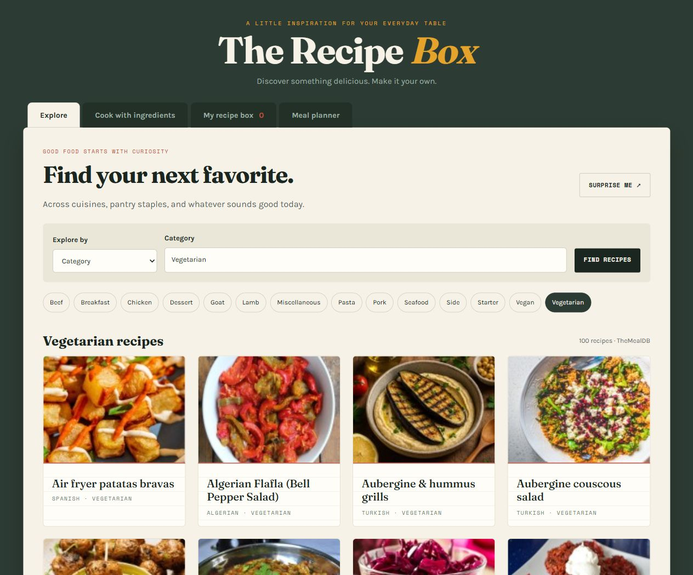

# The Recipe Box

Discover recipes from around the world, turn your ingredients into a meal, and plan your week—all in one React app.

**[Open the live app →](https://recipe-box-lake-nine.vercel.app)**



## Features

| Explore | Cook | Keep & plan |
| --- | --- | --- |
| Search recipes by name | Generate a recipe from your ingredients | Save complete recipes in your browser |
| Browse all available categories | Adjust servings and ingredient quantities | Write and edit your own recipes |
| Discover cuisines and regions | Request substitutions and review changes | Add favorites, collections, ratings and notes |
| Filter by one main ingredient | Check off steps and start cooking timers | Plan meals and combine shopping ingredients |
| Find a random recipe | Restore cooking progress after a refresh | Export and import JSON backups |

AI-generated recipes are clearly labeled as suggestions. You review a proposed revision before applying it; a failed request leaves the existing recipe intact.

## Built with

- **Frontend:** React 18, React Router 7, Vite 8 and plain CSS.
- **AI:** Groq's OpenAI-compatible API with `openai/gpt-oss-20b`.
- **Recipe catalogue:** TheMealDB.
- **Backend:** Node.js locally and Vercel Functions in production.
- **Storage:** Browser `localStorage`; no database or user accounts.
- **Tests:** Node.js's built-in test runner.

## Run locally

Requires **Node.js 22.12+**; Node 24 is recommended.

### Windows / PowerShell

```powershell
npm.cmd install
Copy-Item .env.example .env
```

Open `.env` and configure:

```env
GROQ_API_KEY=your_groq_api_key
GROQ_BASE_URL=https://api.groq.com/openai/v1
GROQ_MODEL=openai/gpt-oss-20b
PORT=5173
```

Create a key in [Groq Console](https://console.groq.com/keys). Keep it in `.env`, which is excluded from Git. Never put a secret in frontend code or a `VITE_` variable.

Start the app:

```powershell
npm.cmd start
```

Open **http://127.0.0.1:5173**. Restart the server after changing `.env`.

On macOS/Linux, use `npm` instead of `npm.cmd`, and `cp .env.example .env` to copy the configuration.

Without an API key, recipe browsing, manual recipes, the library, timers and meal planning still work. AI generation and substitutions require a configured Groq key.

## How it works

1. Enter ingredients, servings, cuisine preferences and available time.
2. The browser sends the request to `/api/generate`.
3. The server asks Groq for a recipe using a strict JSON schema.
4. Both server and browser validate the response before displaying it.
5. The recipe becomes an interactive card with serving controls, cooking steps, timers and notes.

For a substitution, the model receives the current recipe and your requested change. It returns a complete revision, including affected ingredients and instructions. Your notes, meal plan and other saved recipes are not sent.

## Handling unreliable AI output

- Reject malformed JSON, incorrect types, empty ingredient lists and invalid quantities or timers.
- Handle provider failures, refusals, quota limits and incomplete responses with clear errors and a retry action.
- Bound requests with a 45-second server timeout and a 55-second client timeout.
- Cancel in-flight requests and use a separate sequence guard to prevent stale responses from replacing newer results.
- Preserve the current recipe on failure; no automatic retries that consume extra API usage.
- Reset checklists and timers when applying a revision so progress cannot attach to different steps.

## Project structure

```text
api/                         Vercel function entry points
server/                      Local server and Groq integration
shared/recipe.js             Recipe schema, validation and quantity calculations
src/components/              Reusable UI components
src/context/                 Browser library and persistence
src/hooks/                   Requests, cancellation and state
src/pages/                   Explore, Cook, Recipe Box, Editor and Planner
src/services/                Browser API clients
src/utils/                   Backup validation and calendar helpers
src/styles/                  Original visual identity and expanded layouts
tests/                       Validation, API and data-handling tests
```

## Checks

```powershell
npm.cmd test
npm.cmd run build
```

The 15 automated tests cover structured output, provider errors, client validation, stale-request protection, serving calculations, shopping lists, backups and week calculations.

Browser checks covered manual recipe creation, serving changes, restored progress and notes, timer completion, meal planning, recipe discovery and a mobile layout. Production verification confirmed that the homepage, cooking page and API status endpoint respond successfully, and that Groq returns a complete recipe.

## Deployment

The app is deployed on **[Vercel](https://recipe-box-lake-nine.vercel.app)**.

Configure `GROQ_API_KEY` as a server-side secret, plus `GROQ_BASE_URL` and `GROQ_MODEL`, in the Vercel project's Production environment. Build with `npm run build` and use `dist` as the output directory. The `api/` functions handle generation and configuration status; API routes are excluded from the SPA rewrite.

`npm start` runs the local frontend and backend together. `npm run preview` serves only the built frontend and does not include AI endpoints.

## Limitations & data

- **Local storage:** Your library belongs to this browser and origin. Clearing browser data removes it; use JSON backups to move or preserve it. Localhost and the live site have separate libraries.
- **Source measurements:** TheMealDB recipes may omit base servings and use textual measures. Imported quantities represent one original batch. Set numeric amounts and the correct base servings in Edit before scaling.
- **Shopping quantities:** Only matching ingredient names and units are combined. The app does not convert cups to grams or merge synonyms.
- **Timers:** Timers restore after refresh and show elapsed alerts on return, but do not send OS notifications while the app is closed.
- **AI suggestions:** Generated recipes are not tested recipes or certified dietary advice. Review ingredients and cooking instructions before use.
- **Service limits:** Groq and TheMealDB quotas apply. The catalogue may cap results. There is no app-level authentication or durable rate limiting.
- **Scope:** No cloud sync, database, nutrition estimates or streaming. Concurrent edits in multiple tabs are not synchronized.

## Credits & AI assistance

Built by [Mayank](https://github.com/Afro-dude), expanding the original Recipe Box recipe browser and its pantry-green, paper-card visual style.

Codex assisted with architecture, implementation, documentation and tests.

- [TheMealDB API](https://www.themealdb.com/api.php)
- [Groq structured outputs](https://console.groq.com/docs/structured-outputs)
- [Groq OpenAI compatibility](https://console.groq.com/docs/openai)
